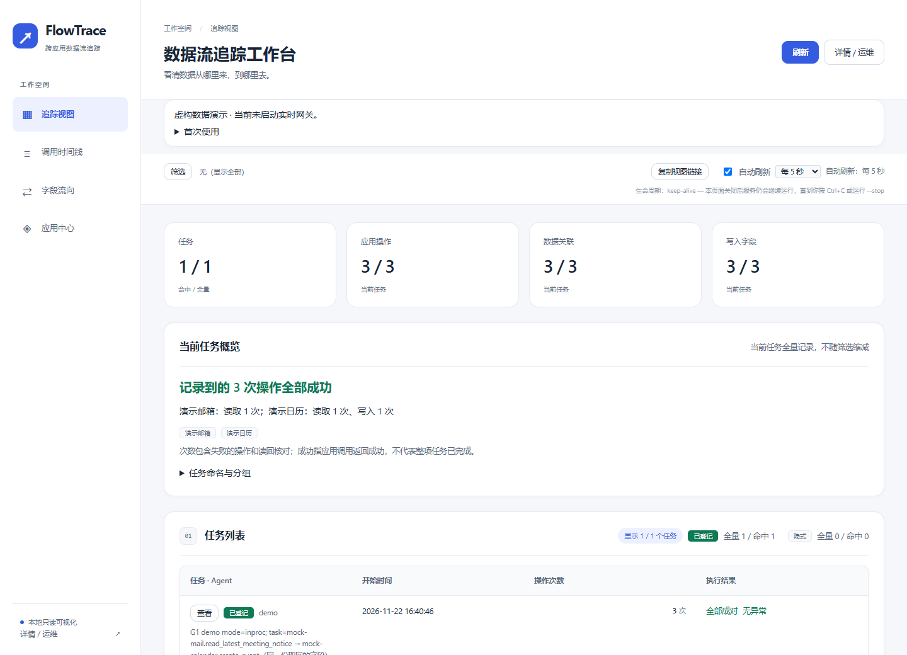
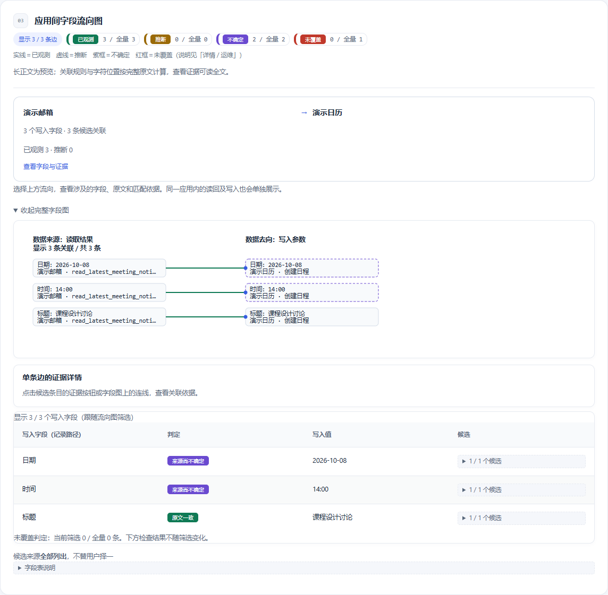
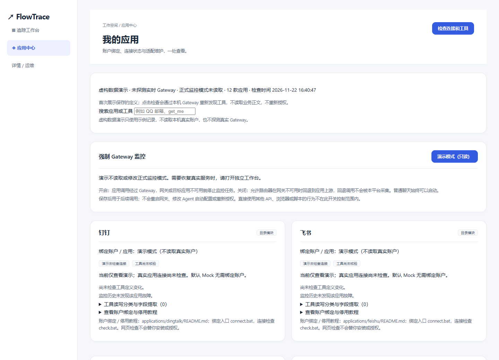

# FlowTrace

FlowTrace 是一个本地运行的跨应用智能体数据流监控工作台。它记录 Codex 和 DeepSeek Harness 经 MCP 网关发起的操作，让你在浏览器里查看一次任务读了什么、写到哪里，以及字段之间有哪些可核对的关联。



## 快速开始

安装 **Node.js 24 或更高版本**，在项目根目录运行：

```sh
npm ci
npm run demo:view
```

打开 `http://127.0.0.1:8788/`，即可查看一组虚构的邮件读取、日历创建和读回记录。演示无需授权。Windows 也可以在安装依赖后双击 `start-demo.bat`。如果 PowerShell 阻止执行 `npm.ps1`，请用 `npm.cmd` 运行上述命令。

在「字段流向」中展开应用卡片或点击字段图的连线，可以查看并收起证据。任务支持命名、搜索、分组和筛选，长正文可按需查看。

<details>
<summary>查看字段流向和应用中心截图</summary>

**字段流向**展示数据的读取位置、写入位置和匹配依据。



**应用中心**展示绑定信息、连接状态、工具可用性和故障处理提示。



</details>

## 连接自己的应用

1. 在 [应用目录](applications/README.md) 选择应用，按说明绑定自己的账户。
2. 按 [安装与启动](docs/user/INSTALL.md) 加载所选应用，然后为 [Codex 或 DeepSeek Harness 配置路由](applications/agent-routing/README.md)。
3. 在应用中心检查连接与工具，发起一次操作，再到时间线确认记录。

| 应用类别 | 支持的服务 |
| --- | --- |
| 邮件与日历 | Gmail、QQ 邮箱、Google Calendar |
| 文档与表格 | Google Docs、Drive、Sheets、飞书、腾讯文档、Notion |
| 代码托管 | GitHub、Gitee |
| 办公协作 | 钉钉 |

`npm run serve -- --no-open` 启动默认的实时本地模拟网关和工作台。工作台默认使用端口 `8787`，网关使用 `8790`。接入真实应用时按安装说明加载已绑定的应用。

强制监控开启时，网关不可用会阻止受管应用操作。关闭时，可在故障期间使用已经授权的直连入口，操作会标记为未监控。服务故障时可用 `npm run workbench` 或 `open-workbench.bat` 打开独立应用中心，查看并调整开关。

## 使用文档

- [任务、时间线和字段流向](docs/user/task-workbench.md)
- [强制监控与离线恢复](docs/user/MONITORING_SWITCH.md)
- [账户与凭据](docs/user/credentials.md)
- [停用与取消授权](docs/user/DISCONNECT.md)
- [常见问题](docs/user/troubleshooting.md)

应用教程和连接脚本位于 `applications/`，用户说明位于 `docs/`。网关、采集、字段分析及界面源码位于 `src/`，启动和诊断入口位于 `bin/` 与 `tools/`。

监控覆盖经过本项目网关和受管路由的 MCP 调用。字段匹配提供可回溯的证据，实际业务意图仍需结合调用记录判断。工作台可显示完整业务数据，请妥善保管本机数据库和导出的文件。
